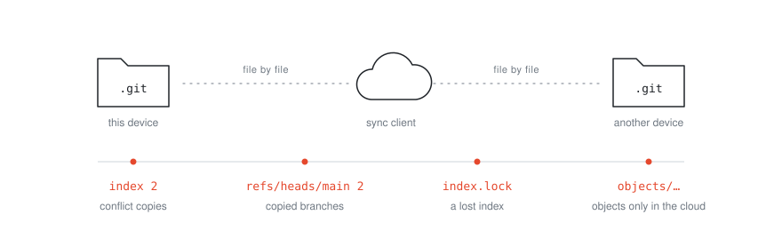
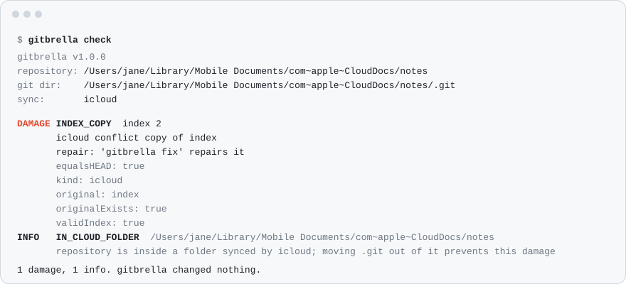
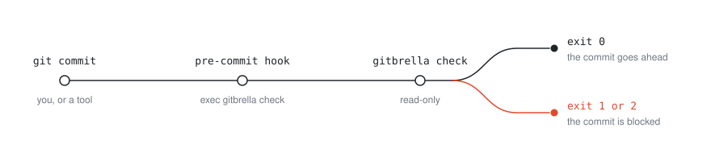
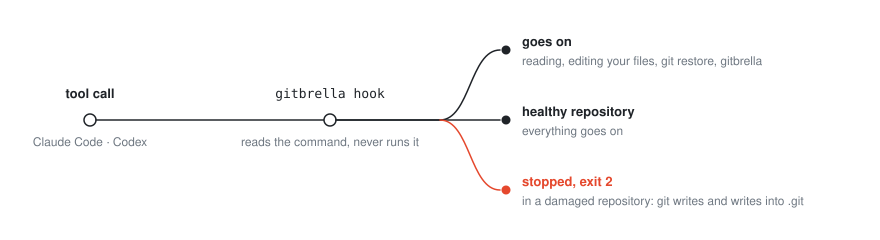
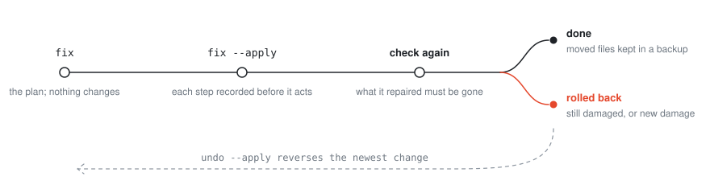
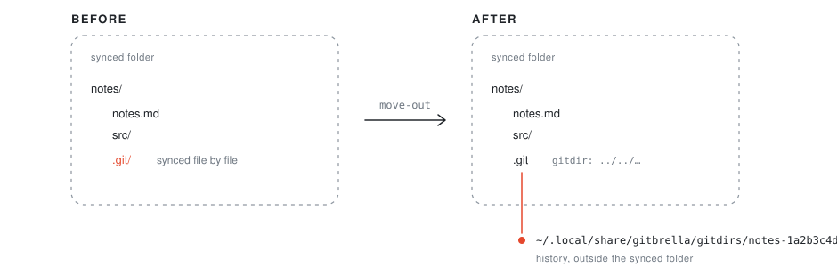
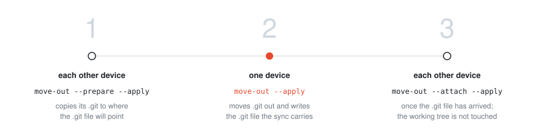

<p align="center">
  
</p>

<h1 align="center">gitbrella</h1>

<p align="center">
  클라우드 동기화가 git 저장소에 입힌 손상을 찾아냅니다.<br>
  아무것도 바꾸지 않고, 아무것도 내려받지 않습니다.
</p>

<p align="center">
  <a href="https://github.com/aliyilmazco/gitbrella/actions/workflows/ci.yml"></a>
  <a href="https://github.com/aliyilmazco/gitbrella/releases"></a>
  <a href="https://pkg.go.dev/github.com/aliyilmazco/gitbrella"></a>
  <a href="../../LICENSE"></a>
</p>

<p align="center">
  <a href="../../README.md">English</a> ·
  <a href="README.zh-CN.md">简体中文</a> ·
  <a href="README.zh-TW.md">繁體中文</a> ·
  <a href="README.ja.md">日本語</a> ·
  <b>한국어</b> ·
  <a href="README.es.md">Español</a> ·
  <a href="README.pt-BR.md">Português</a> ·
  <a href="README.fr.md">Français</a> ·
  <a href="README.de.md">Deutsch</a> ·
  <a href="README.it.md">Italiano</a> ·
  <a href="README.ru.md">Русский</a> ·
  <a href="README.uk.md">Українська</a> ·
  <a href="README.pl.md">Polski</a> ·
  <a href="README.tr.md">Türkçe</a> ·
  <a href="README.ar.md">العربية</a> ·
  <a href="README.hi.md">हिन्दी</a> ·
  <a href="README.id.md">Bahasa Indonesia</a> ·
  <a href="README.vi.md">Tiếng Việt</a>
</p>

<p align="center">
  <a href="#usage">사용법</a> ·
  <a href="#repairing">복구</a> ·
  <a href="#moving-git-out-of-the-synced-folder">.git 옮기기</a> ·
  <a href="#what-it-reports">보고 항목</a> ·
  <a href="#install">설치</a> ·
  <a href="#limits">한계</a>
</p>

iCloud Drive, Dropbox, OneDrive, Google Drive, Syncthing은 파일을 하나씩 동기화합니다. 반면 git은 `.git` 디렉터리가 하나의 단위로 바뀐다고 가정하기 때문에, 동기화 폴더 안의 저장소에는 `.git/index 2`나 `refs/heads/main 2` 같은 충돌 사본, 남겨진 `index.lock` 옆에서 사라진 index, 클라우드에만 존재하는 객체가 생깁니다. git 자체 FAQ도 동기화 폴더에 저장소를 두지 말라고 경고하지만, 기본 설정은 계속 저장소를 그곳에 둡니다. macOS의 iCloud 데스크탑 및 문서, Windows의 OneDrive 폴더 백업, `Documents/GitHub` 같은 곳입니다.

<p align="center">
  
</p>

`gitbrella check`는 보통 1초 이내에 저장소에 그런 손상이 있는지 알려 줍니다. AI 에이전트나 git 훅이 저장소를 건드리기 전에 실행하도록 만들어졌습니다. `gitbrella fix`는 올바른 복구 방법이 하나뿐인 것을 고치고, `gitbrella move-out`은 손상을 근본적으로 끝냅니다. `.git`을 동기화 폴더 밖으로 옮기고 그곳을 가리키는 `.git` 파일을 남기므로, 동기화 클라이언트는 파일을 옮기고 git은 기록을 자기 곁에 둡니다.

| 명령 | 하는 일 |
| --- | --- |
| `gitbrella check` | 손상을 보고 (읽기 전용) |
| `gitbrella fix` | 정답이 하나뿐인 것을 복구 |
| `gitbrella move-out` | `.git`을 동기화 폴더 밖으로 영구히 이동 |
| `gitbrella undo` | 마지막 복구나 이동을 되돌림 |
| `gitbrella history` | 이 기기에서 한 변경 목록 |
| `gitbrella prune-backups` | 더는 되돌릴 수 없는 변경의 오래된 백업 삭제 |
| `gitbrella hook --for claude\|codex` | AI 에이전트의 도구 호출 보호 |

## 빠른 시작

**1. 확인하기.** 읽기 전용이며, 다운로드도 네트워크도 사용하지 않습니다.

```sh
cd ~/Library/Mobile\ Documents/com~apple~CloudDocs/notes
gitbrella check               # 종료 코드 0: 정상, 1: 손상, 2: 실행 불가
```

**2. 복구하기.** 정답이 하나뿐인 것만 고칩니다. `--apply` 없이는 계획만 보여 줍니다.

```sh
gitbrella fix                 # 무엇을 고치고 무엇을 당신에게 맡기는지
gitbrella fix --apply         # 고치기; `gitbrella undo --apply`로 되돌릴 수 있음
```

**3. 근본적으로 끝내기.** `.git`을 동기화 폴더 밖으로 옮깁니다.

```sh
gitbrella move-out            # 무슨 일이 일어나고 무엇이 막는지
gitbrella move-out --apply
```

**계속 보호하기.** 손상된 저장소에서 커밋을 막습니다.

```sh
printf '#!/bin/sh\nexec gitbrella check\n' > .git/hooks/pre-commit
chmod +x .git/hooks/pre-commit
```

AI 에이전트는 [에이전트용](#for-agents)을 참고하세요.

## 약속하는 것

-  **`check`는 읽기 전용입니다.** 저장소에 절대 쓰지 않습니다. git은 `GIT_OPTIONAL_LOCKS=0` 상태로, 자동 gc와 유지 관리를 끈 채 읽기 명령만 실행합니다. 위험한 경우(index 사본, 누락된 index, 부분 클론, 분할 index, 옮겨진 git 디렉터리)에 대한 종단 간 테스트는 검사 전후로 모든 파일의 크기, mtime, inode를 기록하고 서로 같은지 확인합니다.
-  **클라우드에서 내려받지 않습니다.** macOS에서는 디스크를 건드리기 전에 자기 프로세스(와 실행하는 git)의 주문형 다운로드를 끕니다. macOS가 이를 거부하면 검사는 실행되지 않습니다(종료 코드 2). iCloud에만 있는 파일은 보고될 뿐 가져오지 않습니다.
-  **네트워크를 쓰지 않습니다.** 부분 클론은 누락된 객체를 절대 가져오지 않습니다(`GIT_NO_LAZY_FETCH`). 2.45보다 오래된 git에서는 대신 객체 검사를 건너뜁니다.
-  **정상 저장소에서는 조용합니다.** 잠금은 오래되었고, 그 저장소(어느 워크트리든)에서 실행 중인 어떤 git도 그것을 썼을 수 없을 때만 손상으로 봅니다. git은 잠금을 얻을 때 만들기 때문에, 나중에 시작한 git이 그것을 쥐고 있을 수는 없습니다. git의 임시 파일과 `.git` 안의 다른 도구 파일은 정보로 다룹니다. 사용 중인 정상 저장소 89개에서 실행했을 때 손상은 하나도 보고되지 않았습니다.

<a name="usage"></a>

## 사용법

```
gitbrella check [--json] [--deep] [--provider NAME] [path]
```

종료 코드: **0** 손상 없음, **1** 손상 발견, **2** 검사를 실행할 수 없음. 무언가를 바꾸는 명령(`move-out`, `fix`, `undo`)의 종료 코드는 **0** 계획됨, 완료됨 또는 할 일 없음(`already`), **1** 거부됨(이유 포함), 경고와 함께 완료됨, 또는 당신에게 맡겨진 손상이 남음(`fix`의 MANUAL 목록이며 `check`는 계속 보고함), **2** 실패(롤백되거나 중단됨; JSON에 복구한 것과 저널 항목이 남음) 또는 실행 불가입니다.

`--deep`은 전체 `git fsck`도 실행합니다(모든 객체를 읽으므로 객체가 클라우드에만 있으면 건너뜁니다). `--provider`는 경로로 감지하는 대신 동기화 클라이언트를 강제로 지정합니다: `auto`(기본값), `icloud`, `icloud-desktop-documents`, `dropbox`, `onedrive`, `google-drive`, `syncthing`, `nextcloud`, `cloud-storage`, `none`. Syncthing과 Nextcloud(또는 ownCloud) 폴더는 어디에 있든 클라이언트가 그 안에 두는 표식(`.stfolder`, `.sync_*.db`)으로 인식합니다. `fix`와 `move-out`도 같은 `--provider`를 받습니다. 일부 사본 이름은 특정 클라이언트에서만 유효하므로 `check`에 준 값과 같은 값을 주세요. 이때 JSON에는 `"providerForced": true`가 표시됩니다.

<p align="center">
  
</p>

<details>
<summary>같은 출력 (텍스트)</summary>

```
$ gitbrella check
gitbrella v1.0.0
repository: /Users/jane/Library/Mobile Documents/com~apple~CloudDocs/notes
git dir:    /Users/jane/Library/Mobile Documents/com~apple~CloudDocs/notes/.git
sync:       icloud

DAMAGE INDEX_COPY  index 2
       icloud conflict copy of index
       repair: 'gitbrella fix' repairs it
       equalsHEAD: true
       kind: icloud
       original: index
       originalExists: true
       validIndex: true
INFO   IN_CLOUD_FOLDER  /Users/jane/Library/Mobile Documents/com~apple~CloudDocs/notes
       repository is inside a folder synced by icloud; moving .git out of it prevents this damage

1 damage, 1 info. gitbrella changed nothing.
```

</details>

### git 훅으로

```sh
#!/bin/sh
# .git/hooks/pre-commit
exec gitbrella check
```

<p align="center">
  
</p>

손상된 저장소에서는 커밋이 차단되고, 정상 저장소에서는 평소처럼 커밋됩니다. 이 도구는 git이 훅을 실행 중이라는 것을 알기 때문에, 커밋 자신의 잠금을 오래된 잠금으로 착각하지 않습니다.

**어떤 저장소를 검사하나.** 커밋 훅(git이 `GIT_INDEX_FILE` 또는 절대 경로 `GIT_DIR`을 넘겨 주는 훅)에서는 훅을 실행한 git 프로세스로부터 저장소를 찾습니다. 그래서 훅이 먼저 디렉터리를 바꿔도 됩니다. git 디렉터리나 그 hooks 디렉터리, 또는 어느 저장소에도 속하지 않는 디렉터리로 가도 괜찮습니다. git이 절대 경로 `GIT_DIR`로 저장소를 지정하면(연결된 워크트리, 서브모듈, 분리된 git 디렉터리) 훅이 어디로 가든 훅 안의 모든 git 명령이 그 저장소에 작용하고, 검사도 마찬가지입니다. 그렇지 않으면 git 자체가 현재 디렉터리에서 어디로 이어지는지(그곳에서 상대 경로 `GIT_DIR`이 가리키는 git 디렉터리, 또는 그곳에서 찾아지는 저장소)를 확인합니다. 그것이 다른 저장소이거나 같은 저장소의 다른 워크트리라면(그곳으로 이동하는 훅, 또는 커밋 메시지 편집기) 잘못된 저장소에 대해 답하는 대신 거부합니다(종료 코드 2).

경로 없이 실행하면 git이 훅에 내보낸 저장소(`GIT_DIR`)를 검사하므로, `--git-dir`를 쓰는 dotfiles 구성이나 자기 워크트리 안에 있는 git 디렉터리에서도 동작합니다. 경로 없이 실행하면 셸에서 설정한 `GIT_DIR`도 따릅니다. git과 달리 존재하지 않는 `GIT_DIR`은 무시하고, 따라갈 수 없는 연결된 워크트리는 현재 디렉터리를 작업 트리로 취급하는 대신 거부합니다.

**커밋이 기록하는 index.** `GIT_INDEX_FILE`이 git 디렉터리 안의 파일을 가리키면(git이 커밋 훅에 이렇게 설정합니다) 그것을 읽습니다. 커밋이 기록할 index가 없거나 비어 있거나, 작업 트리에 아직 있는 HEAD 파일을 더는 나열하지 않으면, 커밋이 그 파일들을 삭제로 기록하기 전에 차단합니다. 당신이 직접 `GIT_INDEX_FILE`로 다른 곳의 index 파일을 지정하면 그것은 읽지 않습니다. 훅 안에서는 대신 저장소 자체의 index를 검사하고, 이 변수를 설정한 채 수동으로 실행한 검사는 거부됩니다(종료 코드 2).

**의도적인 삭제.** 디스크에 남겨 둘 파일의 추적을 멈추거나(`git rm --cached`, 앞으로 무시할 디렉터리의 추적 해제), 파일이 디스크에 아직 있는 상태에서 의도적으로 "모두 삭제"를 커밋하려면(`git rm -r --cached .`) `git commit --no-verify`로 훅을 건너뛰세요.

### 훅 관리자와 함께

- **pre-commit** (pre-commit.com): 이 저장소를 훅 ID `gitbrella`(pre-commit이 Go로 빌드)나 `gitbrella-system`(PATH의 바이너리)으로 추가합니다. `.pre-commit-hooks.yaml`을 참고하세요.
- **lefthook**: `remotes`로 `hooks/lefthook.yml`을 가져옵니다.
- **husky**: `gitbrella check`를 담은 `.husky/pre-commit`.
- **Overcommit**: `PreCommit: { Gitbrella: { enabled: true, required_executable: gitbrella, command: [gitbrella, check] } }`를 설정하고 `overcommit --sign`을 실행합니다.

모든 도구에서 0이 아닌 종료 코드는 커밋을 멈추므로, 실행되지 못한 검사(종료 코드 2)도 커밋을 멈춥니다. Aider는 `git-commit-verify: true`를 설정하지 않으면 `--no-verify`로 커밋하며, 이때는 커밋 훅이 전혀 실행되지 않습니다. Obsidian Git(데스크톱)은 시스템 git으로 커밋하고 훅을 실행합니다. Dock에서 실행한 앱은 셸의 PATH를 받지 않으므로 `gitbrella`가 있는 폴더를 "Additional PATH" 설정에 추가하세요. 모바일 Obsidian Git(isomorphic-git)은 훅을 실행하지 않습니다.

<a name="for-agents"></a>

### 에이전트용

`--json`은 같은 보고서를 안정적이고 버전이 붙은 문서로 출력합니다(`schemaVersion: 1`, `findings`는 항상 목록). 종료 코드로 판단하고 발견 사항을 사용자에게 보여 주세요.

에이전트 자체의 훅은 종료 코드 2일 때만 도구 호출을 멈춥니다. 종료 코드 1("손상 발견")에서는 호출이 그대로 진행됩니다. `gitbrella hook --for claude|codex`는 그 훅들의 규칙에 맞춰 동작하며, 에이전트가 stdin으로 넘기는 이벤트를 읽습니다.

<p align="center">
  
</p>

- **도구 호출 전** (`PreToolUse`): 손상된 저장소에서는 쓰기를 하는 git 명령(commit, add, reset, rebase, push 및 읽기 전용으로 알려지지 않은 모든 것)과 `.git` 안으로의 쓰기가 호출을 멈춥니다(종료 코드 2, 이유는 에이전트를 위해 stderr에 출력). 읽기, 파일 편집, `git restore`, 그리고 `gitbrella` 자체는 진행되므로 손상을 조사하고 고칠 수 있습니다.
  - *쓸 수 없는 저장소.* git 파일이 클라우드에만 있거나 git이 저장소를 전혀 쓸 수 없으면(이름이 바뀐 `HEAD`, 아무 데도 가리키지 않는 `.git` 파일) 모든 git 명령이 멈춥니다. 멈춰 버리거나 바깥 저장소에 작용할 것이기 때문입니다. 이 경우 `.git` 안으로의 쓰기는 진행됩니다. 이유에서 말하듯 그 복구는 `.git` 안에서 손으로 하는 것이기 때문입니다(`mv '.git/HEAD 2' .git/HEAD`). `core.worktree` 힌트가 제시하는 조치(`git config --file … --unset core.worktree`)도 진행됩니다.
  - *어떤 저장소인가.* 호출이 다루는 파일을 담고 있는 저장소입니다(Codex 패치는 자기 파일을 명시합니다. `.git` 안의 경로는 그 위의 작업 트리로 취급됩니다). 셸 명령이라면 세션 폴더와 그 git 명령이 실행되는 모든 폴더(`cd DIR`, `pushd`, `git -C DIR`, `--git-dir`, `--work-tree`, `GIT_DIR`, `env -C`, `bash -c '…'`)이며, 쓰기를 하는 것을 우선해 최대 5개입니다. 쓰기를 하는 것이 다 들어가지 않으면 호출은 알림과 함께 통과합니다. 각 폴더는 호출이 그곳에서 하는 일로 판단합니다. 손상된 세션 폴더에서 실행한 `git -C ../sound commit`은 진행됩니다. 저장소가 아닌 폴더와 bare 저장소는 조용히 통과합니다.
  - *검사를 실행할 수 없을 때.* 검사 실행을 막는 것이 있으면(20초 `--timeout` 포함, 이는 전체 호출에 대한 하나의 기한) 호출은 알림과 함께 통과합니다. `--fail-open`은 git이 저장소를 쓸 수 없는 경우도 같은 방식으로 다룹니다.
  - *명령을 읽는 방법.* 명령은 읽기만 하고 절대 실행하지 않습니다. 따옴표, 주석, 서브셸, 치환(따옴표 없는 heredoc 안 포함), heredoc, 명령이 설정하는 변수, `&&`, `||`, `if`, `case`, 반복문(`cd a || cd b` 뒤나 존재하지 않는 폴더로의 `cd` 뒤에는 셸이 있을 수 있는 모든 폴더가 대상이 됩니다. `for` 반복문은 값마다 한 번씩 읽습니다), 래퍼(`timeout`, `sudo`, `nice`, `xargs`, `env`), 셸에 넘겨지는 스크립트(`-c`, `eval`, `watch`, `source`, 파일, heredoc, `bash < f`, `sh`로의 파이프)를 읽습니다. 명령이 정의한 함수와 별칭은 호출되는 곳에서 읽습니다. 경로로 실행되거나 셸에 넘겨지는 셸 스크립트(`./deploy.sh`, `bash deploy.sh`)는 이 기기에 있는 작은 파일이면 읽습니다(심볼릭 링크를 거쳐도, 자기 자신을 실행해도 한 번만). `make`, `npm run` 등은 읽지 않습니다.
  - *쓰기로 보는 것.* 다른 프로그램이 `.git` 안에 쓰는 것(`rm .git/index.lock`, `> .git/HEAD`, `cd .git && rm index.lock`, `.git/config`에 대한 `sed -i`, `.git`을 담은 폴더에 대한 `rm -rf`나 `find -delete`, 셸을 통한 Codex 패치)은 `.git` 쓰기로 봅니다. `.git`을 다른 곳으로 복사하거나 `tar`로 묶거나 읽는 것은 해당하지 않습니다. `gh pr checkout`과 `git-lfs`는 쓰기를 하는 git 명령으로 봅니다.
  - *확신이 없을 때.* 다음은 각각 쓰기를 하는 git 명령으로 봅니다: 5000단계나 `--timeout`의 절반을 넘는 읽기(판단할 수 없었던 폴더에서), 읽기가 추적하지 않는 위치의 `git`이라는 단어, 읽기가 추적하지 않는 프로그램에서 셸로 파이프되는 스크립트(`curl … | sh`, 실행되는 곳에서), 존재하지만 읽을 수 없는(너무 크거나 클라우드에만 있는) 셸에 넘겨지는 스크립트(실행되는 곳에서). git 명령이 쓰는 폴더를 판단할 수 없으면(`cd "$(…)"`, `for d in */`) 그 명령은 검사하는 모든 폴더에서 고려되고 호출에는 알림이 붙습니다.
- **세션 시작 시** (`SessionStart`): stdout에 한 줄을 출력하고 에이전트는 이를 컨텍스트로 읽습니다. 저장소가 동기화 폴더 안에 있다는 것(git 디렉터리가 이미 밖에 있지 않은 한)과 무엇이 손상되었는지를 알려 줍니다. 절대 차단하지 않습니다.

훅은 아무것도 바꾸지 않습니다. Claude Code에서는 `.claude/settings.json`에:

```json
{
  "hooks": {
    "SessionStart": [{"hooks": [{"type": "command", "command": "gitbrella hook --for claude"}]}],
    "PreToolUse": [{"matcher": "Edit|Write|MultiEdit|NotebookEdit|Bash",
                    "hooks": [{"type": "command", "command": "gitbrella hook --for claude"}]}]
  }
}
```

Codex에서는 `.codex/hooks.json`에 (Codex는 `/hooks`에서 훅을 신뢰한 뒤에만 실행합니다):

```json
{
  "hooks": {
    "SessionStart": [{"hooks": [{"type": "command", "command": "gitbrella hook --for codex"}]}],
    "PreToolUse": [{"matcher": "Bash|apply_patch",
                    "hooks": [{"type": "command", "command": "gitbrella hook --for codex"}]}]
  }
}
```

검사는 이 폴더마다 한 번, 보통 각각 0.1~0.4초 걸립니다. 그래서 한 저장소의 여러 폴더에 걸친 패치는 그 저장소를 여러 번 검사합니다. `--timeout`은 전체 호출 시간을 제한합니다.

<a name="repairing"></a>

## 복구

```sh
gitbrella fix                 # 무엇을 고치고 무엇을 당신에게 맡기는지
gitbrella fix --apply         # 고치기
gitbrella undo --apply        # 모두 되돌리기
gitbrella history             # 여기서 한 변경, 그 백업과 크기
gitbrella prune-backups       # 어떤 undo에도 더는 필요 없는 백업
```

<p align="center">
  
</p>

`check`는 각 손상 아래에 `fix`로 고칠 수 있는지를 표시합니다(`repair:`, JSON에서는 `"repair": "fix"` 또는 `"manual"`). 검사에 provider가 지정되었다면 `fix --provider NAME`도 보여 줍니다. 커밋 훅 안에서는 묻지 않습니다.

`fix`는 정답이 하나뿐이고, 당신이 의도했을 수도 있는 것을 아무것도 덮어쓰지 않을 때만 복구합니다.

| 손상 | 복구 |
| --- | --- |
| `.git` 안에서 원본 옆에 있는 충돌 사본(`HEAD 2`, `refs/heads/main 2`, `refs 2`, `packed-refs 2`, Dropbox와 Syncthing의 사본, 그리고 `refs/heads/main 2.lock` 같은 ref 잠금의 사본). index 사본은 index와 완전히 같거나 HEAD와 같은 유효한 index인 경우만 | 백업으로 이동. 사본만 가리키던 객체(커밋, 태그, 트리, 파일)는 먼저 `refs/gcd-rescue/<name>`으로 보존 |
| 남겨진 rebase 디렉터리, `desktop.ini`, `Icon` 등 git이 만들지 않은 유사 파일(git이 브랜치로 읽는 것이나 객체 이름을 가진 것 제외), 저장소가 그 커밋을 가진 작업 트리 내 `.git` 사본 | 백업으로 이동 |
| index가 없고 그 사본이나 잠금도 어디에도 없음 | HEAD로부터 생성(`git read-tree HEAD`: 파일은 건드리지 않음). 기반이 될 커밋이 있고(HEAD 커밋도 없다면 아래처럼 먼저 가져옴) 스파스 체크아웃이 아닌 경우만 |
| 파일을 하나도 나열하지 않는 index(스파스 체크아웃 밖의, 유효하고 분할되지 않은 index) | 백업으로 이동하고 HEAD로부터 생성: 스테이징된 것이 없었음 |
| HEAD와 같은 유효한 index인 외톨이 `index.lock` | 그것을 index로 만듦 |
| 빈 브랜치 파일 | 그 reflog가 마지막으로 기록한 커밋 |
| git이 커밋에 넣어 버리는 `.git.nosync` | `.git/info/exclude`에 `/.git.nosync/` 줄 추가 |
| HEAD 커밋 누락 또는 빈 loose 객체 파일(옆에 사본 없음) | 빈 파일을 백업으로 옮기고 객체를 다시 가져옴(`git fetch --refetch`, git 2.36+). 출처는 `--remote`, 없으면 브랜치의 리모트, 없으면 `origin`, 없으면 유일한 리모트. 리모트 브랜치와 태그는 이후 삭제되는 임시 `refs/gcd-fetch/` 네임스페이스로 가져오므로 ref는 바뀌지 않음. 리모트가 객체를 되돌려 주지 못하면 복구는 롤백됨 |
| `fix --deep` 사용 시: `git fsck`가 손상을 보고한 객체 | 리모트 브랜치와 태그의 모든 객체를 같은 방식으로 다시 가져옴. 그 후 `git fsck`를 다시 실행하고, 여전히 오류가 보고되면(어느 리모트에도 없는 객체, 남아 있는 손상 파일) 복구는 롤백됨 |
| 당신 파일의 충돌 사본(`notes 2.md`) 중 git이 추적하지 않고 원본과 바이트가 같은 것 | 백업으로 이동(`git add -A`가 커밋해 버리므로). 내용이 다르거나, 추적되거나, 링크이거나, 클라우드에만 있거나, 서브모듈 안에 있는 사본은 그대로 둠 |
| 1시간 넘게 지난 다른 기기의 `gc.pid`, `gc.log` | 백업으로 옮겨 git의 자동 gc가 여기서 다시 동작하게 함 |
| `.git`이나 대체 객체 저장소의 클라우드 전용 파일 | 내려받기만 하고 다른 것은 하지 않음. 그때까지 검사는 객체를 읽을 수 없으므로 나머지 손상은 다음 `fix` 실행을 위해 MANUAL로 표시됨 |

그 밖의 모든 것은 실행할 명령과 함께 MANUAL로 표시됩니다. 여기에는 다른 어디에도 없는 작업을 담고 있을지 모르는 모든 것이 포함됩니다:
- 손상된 index(git이 아직 스테이징된 작업과 함께 읽을 수 있을지도 모릅니다)
- HEAD와 다른 index 사본이나 `index.lock`, 그리고 `index.lock`의 사본
- 원본이 없는 사본(그것이 유일한 것일 수 있으니 제자리로 돌려놓으세요. 단, 잠금의 사본은 보존된 뒤 옆으로 옮겨집니다)
- 이 기기의 어떤 git도 쥐고 있지 않은 잠금(다른 기기나 컨테이너의 git이 쥐고 있을 수 있습니다. 조언에 그 안의 커밋이 표시됩니다)
- 100개가 넘는 객체를 가리키는 사본(긴 reflog)
- 어느 HEAD든 가리키는 브랜치, 그 reflog, 또는 그것을 담은 디렉터리의 사본(이름이 어떻게 보이든 git은 그것을 읽습니다)

그리고 fix가 두 버전 중 하나를 골라야 하거나 사본의 커밋을 지킬 수 없는 모든 경우:
- 객체 저장소 안의 모든 것: 사본, 객체 이름을 가진 파일(어느 것이 해시와 맞는지 확인하세요), 가져올 리모트가 없는 빈 객체 파일
- 서브모듈 git 디렉터리 안의 모든 것(서브모듈 안에서 `fix`를 실행하세요)
- 아직 여기 도착하지 않은 커밋을 가리키는 브랜치 사본(아직 도착할 수 있습니다)
- 저장소에 없는 커밋을 담은 작업 트리 내 `.git` 사본(어느 것이 최신인지는 당신이 판단합니다)
- 자기 자신이나 그 디렉터리의 사본이 옆에 있는 빈 파일
- 망가진 연결 워크트리의 관리 디렉터리(`git worktree repair`)
- 아직 디스크에 있는 파일을 잃은 index(의도적으로 추적을 멈춘 경우도 똑같아 보입니다. 다른 것이 스테이징되지 않았다면, 조언은 `git read-tree HEAD`로 아무것도 잃지 않고 되찾을 수 있다고 알려 줍니다)
- `--deep` 없이 또는 리모트 없이 `git fsck`가 손상을 보고한 객체

`fix`는 reftable 저장소를 전혀 건드리지 않습니다. 거기서는 `check`의 `REFTABLE_TABLE_UNLISTED`가 다른 기기의 ref를 지키는 방법을 알려 줍니다. 백업은 저장소와 같은 디스크에 있어야 합니다. fix가 옮기는 것을 한 번에 이동하기 위해서이며, 그렇지 않으면 `fix`는 거부합니다(아무것도 옮기지 않는 다운로드 전용 복구는 제외).

각 단계는 실행 전에 기록되고, 마지막에 검사가 다시 실행됩니다. 고친 것이 여전히 보고되거나 새 손상이 나타나면 단계는 되돌려집니다. 중단된 fix는 그 저장소에서 다음으로 `--apply`와 함께 실행되는 변경 명령이 롤백하며, 그 명령은 거기서 멈춥니다. 다시 실행하세요. 30초 뒤(`--watch`) `fix`는 한 번 더 검사합니다. 돌아온 손상은 동기화 클라이언트가 다시 가져온 것이며, 영구적인 해결책은 `move-out`입니다.

`undo`는 가장 최근 변경(복구나 이동)부터 되돌립니다. 복구 후 결과가 바뀐 단계는 그대로 두고 목록으로 보여 주며 절대 덮어쓰지 않습니다. 예를 들어 git이 다시 만든 index를 다시 썼거나, 동기화 클라이언트가 사본을 다시 가져왔거나, 구조 ref가 움직였거나, 백업이 삭제되었거나, `.git`이 옮겨진 경우입니다. 구조 ref는 그것이 지키는 사본이 백업에 있는 동안 남아 있습니다. 내려받은 파일은 디스크에 남고, 다시 가져온 객체는 객체 저장소에 남습니다. 둘 다 아무것도 대체하지 않습니다. 나머지는 되돌려지고 undo는 완료되므로, 그 이전 변경을 이어서 되돌릴 수 있습니다.

`history`는 이 기기가 저장소에 한 변경(복구, 이동, undo), 각각이 가진 백업과 크기, 그리고 `undo`가 다음에 무엇을 되돌릴지 보여 줍니다. `prune-backups`는 `--apply`와 함께일 때만, 되돌려졌거나 롤백되었거나 애초에 되돌릴 수 없는(undo, prepare, attach) 변경 중 마지막 단계가 `--older-than`(기본 `720h`)보다 오래된 것의 백업을 삭제합니다. 아직 되돌릴 수 있는 복구나 이동은 그 위에 새 변경이 있어도 백업을 유지합니다.

<a name="moving-git-out-of-the-synced-folder"></a>

## .git을 동기화 폴더 밖으로 옮기기

```sh
gitbrella move-out            # 무슨 일이 일어나고 무엇이 막는지
gitbrella move-out --apply    # 실행
gitbrella undo --apply        # 되돌리기
```

<p align="center">
  
</p>

`move-out`은 `.git`을 `~/.local/share/gitbrella/gitdirs/<name>`으로 복사하고(macOS에서는 APFS 클론: 공간을 차지하지 않음), 사본이 같은지 파일마다 검증하고, 원본을 `~/Library/Application Support/gitbrella`(Linux: `$XDG_STATE_HOME/gitbrella`) 아래의 백업으로 옮긴 뒤, `gitdir: ../../../../.local/share/gitbrella/gitdirs/notes-1a2b3c4d` 같은 `.git` 파일을 씁니다. 경로가 상대 경로이므로, 홈 아래 같은 위치에 폴더를 둔 모든 기기는 같은 `.git` 파일을 씁니다. 그다음 git이 같은 HEAD, 상태, 설정, hooks 디렉터리를 찾는지 확인하고, 30초 동안(`--watch`) 동기화 클라이언트가 `.git`을 건드리지 않는지, 그리고 iCloud라면 새 파일을 업로드하는지 확인합니다. 원본은 마지막 비교 전에 옆으로 옮겨지므로, 복사 중에 끼어든 쓰기는 감지되어 이동이 되돌려집니다. iCloud에서는 iCloud가 아직 저장소를 업로드하는 동안 `move-out`이 거부됩니다. `--wait-upload 10m`을 주면 대신 그 시간까지 기다립니다.

모든 변경은 실행 전에, 만들어 내는 모든 것의 장치와 inode(그리고 `.git` 파일의 바이트)와 함께 저널에 기록됩니다. 롤백은 그 밖의 것을 건드리지 않습니다. 프로세스가 도중에 죽으면, 다음 `move-out --apply`(또는 `undo --apply`)가 그것을 완료하거나 롤백한 뒤 거기서 멈춥니다(계속하려면 명령을 다시 실행하세요). 폴더의 inode로 찾기 때문에 경로를 다르게 써도, 이름이 바뀐 뒤에도, 다른 저장소 안에서도 찾아냅니다. 그동안 `check`는 끝나지 않은 변경을 손상으로 보고합니다. git이 옮겨진 디렉터리를 쓰기 시작한 뒤에는 그 위로 롤백하지 않습니다. 원본에 없는 것이 들어 있으면 명령은 멈추고 둘 다 보여 줍니다. 아무것도 삭제되지 않습니다. 원본은 당신이 지울 때까지 백업에 남습니다. `undo`는 지금 쓰고 있는 git 디렉터리를, 이동 후에 만든 커밋과 함께 되돌려 놓습니다. 이동 전 백업은 건드리지 않습니다. 동기화 클라이언트가 `.git` 파일을 내보낸 상태라면(이 Mac에는 이름만 있음), `undo`와 복구는 먼저 그것을 내려받으라고 요청합니다. 읽으면 다운로드가 일어나는데, 이 도구는 절대 그렇게 하지 않기 때문입니다.

롤백할 때 원본(백업 안)과 새 `.git`(이동이 멈춘 뒤 당신이나 동기화 클라이언트가 만든 것)이 둘 다 발견되면, 어느 쪽도 덮어쓰지 않고 그 사실을 알립니다. 둘을 비교하고, 원하지 않는 `.git`을 폴더 밖으로 옮긴 다음 명령을 다시 실행하세요.

다음 경우에는 거부합니다(종료 코드 1, 이유 포함): git이나 git 잠금을 쥔 무언가가 저장소에서 실행 중인 동안, merge나 rebase 도중, `.git` 파일이 클라우드에만 있는 동안, iCloud가 아직 폴더를 업로드하는 동안, `.git` 안에 소켓이 있는 동안(실행 중인 `git fsmonitor--daemon`), 이동 후 git 디렉터리가 두 개 존재할 때, 그리고 링크가 깨지는 구성일 때: 연결된 워크트리, 서브모듈, 빌린 객체(`alternates`), 심볼릭 링크인 `.git`이나 git 디렉터리 자체가 아닌 `.git`. `check`가 찾은 다른 손상은 그대로 옮겨지고 이월된 것으로 표시됩니다. 나중에 `check`를 다시 실행하세요.

### 다른 기기

동기화 클라이언트는 그 폴더를 동기화하는 다른 모든 기기에서 `.git`을 삭제하고 대신 `.git` 파일을 전달합니다. 그 기기들의 기록을 지키려면:

<p align="center">
  
</p>

1. 이동하기 전, 다른 각 기기에서: `gitbrella move-out --prepare --apply`가 그 기기의 `.git`을 `.git` 파일이 가리킬 곳으로 복사합니다.
2. 한 기기에서: `gitbrella move-out --apply`.
3. `.git` 파일이 도착한 뒤, 다른 각 기기에서: `gitbrella move-out --attach --apply`. 준비하지 않은 기기는 대신 기록을 클론합니다: `--attach --from <remote URL> --apply`. 어느 쪽도 작업 트리는 건드리지 않습니다.

`.git` 파일은 동기화 클라이언트를 통해 도착하므로, attach는 이 기기의 기록이 허락하는 만큼만 그것을 신뢰합니다. 그것은 이 기기의 `~/.local/share/gitbrella/gitdirs` 안을 가리켜야 하며, 그곳에 이미 있는 디렉터리는 `--prepare`가 이 저장소를 위해 만든 것일 때만 사용됩니다.

그 후로 동기화 클라이언트는 파일을 옮기고 기록은 옮기지 않습니다. 커밋은 리모트로 공유하세요. 동기화 클라이언트가 이미 파일을 갱신한 기기에서는 `git pull`이 거부됩니다("would be overwritten"). `git fetch`와 `git reset --mixed @{u}`를 쓰세요. 이것은 브랜치와 index를 옮기고, 동기화된 파일은 그대로 둡니다.

<a name="what-it-reports"></a>

## 보고 항목

손상 (종료 코드 1):

| 코드 | 의미 |
| --- | --- |
| `INDEX_COPY` | index의 충돌 사본(`index 2`; Dropbox, Syncthing, Nextcloud/ownCloud, Proton Drive, Seafile 이름. Google Drive의 `index (1)`, OneDrive 폴더 안의 OneDrive `index-COMPUTER`, 구 Nextcloud, Synology Drive, pCloud, Resilio 이름은 git 자체 파일 이름에 대해서만 대조). 유효한 index인지, HEAD와 일치하는지 표시 |
| `REF_COPY` | 브랜치나 태그 ref의 충돌 사본. 사본이 더 오래됐는지, 더 새로운지, 갈라졌는지, 없는 커밋을 가리키는지 표시 |
| `COPY_IN_GITDIR` | `.git` 안의 다른 충돌 사본 |
| `INDEX_MISSING` | index 없음. git은 모든 파일을 삭제된 것으로 표시(커밋 훅 안에서는: 커밋이 모든 파일을 삭제함) |
| `INDEX_EMPTY` | HEAD 파일이 아직 작업 트리에 있는데 index가 파일을 하나도 나열하지 않음. 동기화 클라이언트가 index를 삭제한 뒤 git이 다시 만들 때 생김. 커밋하면 모든 파일이 삭제됨 |
| `INDEX_SHRUNK` | 작업 트리에 아직 있는 HEAD 파일을 index가 더는 나열하지 않음(스파스 체크아웃에서는: HEAD의 어떤 파일이든). 동기화 클라이언트가 index를 삭제한 뒤 git이 스테이징된 파일로 다시 만들 때 생김. 커밋하면 그것들이 삭제됨. 이름 변경, 심볼릭 링크나 `.gitmodules`에 선언된 서브모듈이 된 디렉터리, 디스크에서도 삭제된 파일은 세지 않음. HEAD 파일을 나열할 수 없으면 미검증으로 보고 |
| `HEAD_COMMIT_MISSING` | HEAD가 저장소에 없는 커밋을 가리킴(ref가 객체보다 먼저 도착함) |
| `ORPHAN_INDEX_LOCK` | index가 없고 오래된 `index.lock`이 남아 있음(대개 완전한 index) |
| `INDEX_INVALID` | index가 자기 체크섬과 맞지 않음 |
| `STALE_LOCK` | 실행 중인 어떤 git도 쥘 수 없는 git 잠금: 저장소에서 실행 중인 git이 없거나, 모든 git이 잠금이 쓰인 뒤에 시작됨. 이 기기의 git 프로세스만 보이므로, 잠금을 지우기 전에 컨테이너, 폴더를 공유하는 다른 기기, git을 내장한 앱에서 저장소를 쓰는 git이 없는지 확인할 것 |
| `DATALESS_IN_GITDIR` | `.git` 안의 파일이 클라우드에만 있음. 객체 검사를 건너뜀 |
| `FOREIGN_FILE_IN_GITDIR` | `refs/`나 `objects/` 안에 git이 만들지 않은 파일(`desktop.ini`, `objects/` 안의 `.tmp` 파일) |
| `EMPTY_FILE_IN_GITDIR` | 0바이트 객체나 ref |
| `GITDIR_COPY` | 작업 트리 안의 git 디렉터리 사본(`.git 2`) |
| `GIT_DIR_NOT_IGNORED` | git 디렉터리가 다른 이름으로 작업 트리 안에 있어(`.git.nosync`) `git add -A`가 커밋해 버림 |
| `WORKTREE_ADMIN_BROKEN` | 연결된 워크트리가 관리 파일을 잃음 |
| `STALE_OPERATION_STATE` | 남겨진 rebase 디렉터리 때문에 git이 rebase 도중이라고 생각함 |
| `FSCK_ERRORS` | `--deep`만: `git fsck`가 오류를 보고함(끝나지 않았다면 같은 코드가 정보가 됨) |
| `REFTABLE_TABLE_UNLISTED` | reftable 저장소에 목록이 이름을 올리지 않은 ref 테이블이 있음: 동기화 클라이언트가 가져온 다른 기기의 테이블로, 그 기기의 목록은 git이 절대 읽지 않는 사본이 됨. 다음 `git pack-refs`나 유지 관리가 그것들을 지우며, 그 기기의 브랜치도 함께 사라짐. 먼저 git 디렉터리를 안전한 곳으로 복사할 것 |
| `CHANGE_UNFINISHED` | gitbrella의 `fix`, `undo`, `move-out`이 끝나지 않음(중단됨). 거기서 git을 쓰기 전에 표시된 명령을 `--apply`와 함께 실행해 완료하거나 롤백할 것 |
| `GIT_DIR_RETURNED` | `move-out` 뒤에 `.git`이 다시 디렉터리가 되어(동기화 클라이언트가 옛것을 가져옴) git 디렉터리가 두 개 존재함. 커밋하기 전에 비교해서 하나만 남길 것 |
| `STAGED_CONFLICT_COPY` | index가 자신도 나열하는 파일의 동기화 충돌 사본을 추가함(`notes.md` 옆의 `notes 2.md`, 복사된 디렉터리 `src 2/`, Syncthing 이름). 커밋하면 사본이 기록에 들어감. 이름으로만 판단함. 그런 이름으로의 이름 변경이나 원본 없는 사본 같은 이름의 파일은 세지 않음. 분할 index에서는 검사하지 않음 |

정보 (종료 코드에 영향 없음): `IN_CLOUD_FOLDER`, `GIT_DIR_NOT_SYNCED`(git 디렉터리가 동기화 폴더 밖으로 옮겨짐: 안전한 구성), `WORKTREE_COPIES`(당신 파일의 충돌 사본), `GIT_RUNNING`, `LOCK_IN_USE`, `LOCK_RECENT`, `IN_PROGRESS_OPERATION`, `UNKNOWN_IN_GITDIR`, `NO_CHECKOUT`, `PARTIAL_CLONE_UNVERIFIED`, `WORKTREE_SCAN_TRUNCATED`, `DEEP_CHECK_SKIPPED`, `REFTABLE_UNSUPPORTED`, `UNREADABLE_IN_GITDIR`, `PROCESS_CHECK_FAILED`, `GIT_DIR_IGNORE_UNCHECKED`, `GIT_TEMP_FILE`, `DATALESS_IN_ALTERNATE`(대체 객체 저장소에 클라우드 전용 파일이 있어 객체 검사를 건너뜀), `GC_PID_FOREIGN`(다른 기기의 `gc.pid`: git이 12시간 동안 자동 gc를 건너뜀), `GC_LOG_FRESH`(하루가 안 된 `gc.log`가 자동 gc를 막음), `HOOKS_IN_SYNCED_FOLDER`(`core.hooksPath`나 `core.fsmonitor` 명령이 git 디렉터리 밖의 동기화 폴더에 있어 다른 기기에서의 변경이 여기서 실행됨), `WORKTREE_GUESSED`(작업 트리 없는 `GIT_DIR`이고 현재 디렉터리에 HEAD 파일이 하나도 없음: 작업 트리는 검사되지 않음).

경로가 아예 저장소가 아니면, 원인이 디스크에 있을 때 그 이유를 알려 줍니다: 이름이 바뀐 `.git 2`, 클라우드에만 있는 git 자체 파일, HEAD 없는 git 디렉터리, 더는 존재하지 않는 git 디렉터리를 가리키는 `.git` 파일, 이 기기에 없는 폴더를 가리키는 `core.worktree`(동기화 클라이언트가 가져온 다른 기기의 설정). 경로에 git이 쓸 수 없는 `.git`이 있으면, git처럼 바깥 저장소에 대해 답하는 대신 거기서 멈춥니다(종료 코드 2).

<a name="install"></a>

## 설치

git 2.31 이상이 필요합니다. macOS와 Linux, amd64와 arm64를 지원하며 cgo를 쓰지 않습니다.

```
go install github.com/aliyilmazco/gitbrella/cmd/gitbrella@latest
```

또는 releases 페이지에서 아카이브를 받으세요.

### 릴리스 검증

각 릴리스에는 `checksums.txt`(각 아카이브와 SBOM의 SHA-256), 릴리스 워크플로가 만든 키리스 cosign 서명 `checksums.txt.sigstore.json`, 아카이브별 SPDX SBOM, GitHub 빌드 출처 증명(build-provenance attestation)이 함께 제공됩니다. 먼저 서명을 확인하고, 그다음 서명된 목록으로 아카이브를 확인하세요(예시는 Apple 실리콘용 v1.2.3). cosign v3.1.3 이상(v2 계열에서는 v2.6.5)을 쓰세요. 더 오래된 버전은 위조된 번들에 속을 수 있습니다(GHSA-fx35-mq7g-6g98).

```sh
cosign verify-blob \
  --certificate-identity 'https://github.com/aliyilmazco/gitbrella/.github/workflows/release.yml@refs/tags/v1.2.3' \
  --certificate-oidc-issuer 'https://token.actions.githubusercontent.com' \
  --bundle checksums.txt.sigstore.json checksums.txt
grep ' gitbrella_1.2.3_darwin_arm64.tar.gz$' checksums.txt | shasum -a 256 -c
gh attestation verify gitbrella_1.2.3_darwin_arm64.tar.gz \
  --repo aliyilmazco/gitbrella \
  --signer-workflow aliyilmazco/gitbrella/.github/workflows/release.yml \
  --source-ref refs/tags/v1.2.3 --deny-self-hosted-runners
```

릴리스는 푸시된 태그로부터 `.github/workflows/release.yml`이 `.goreleaser.yaml`로 빌드하며, 누군가 게시할 때까지 초안으로 남습니다. 바이너리는 `-trimpath`와 커밋 시각으로 빌드되므로, 같은 태그와 같은 Go 릴리스(워크플로는 최신 1.26 패치를 사용)에서 같은 바이너리가 나옵니다. 이를 감싸는 아카이브와 SBOM에는 빌드 시각이 들어갑니다.

<a name="limits"></a>

## 한계

- `fix`는 정답이 하나뿐일 때만 고치고, 나머지는 실행할 명령과 함께 당신에게 맡깁니다. 영구적인 해결책은 `.git`을 동기화 폴더 밖에 두는 `move-out`입니다.
- iCloud가 두 기기 사이에서 직접 만드는 충돌 사본은 테스트에서 재현하지 못했습니다. 감지는 같은 명명 규칙을 따르는 사본으로 테스트했습니다.
- Codex는 셸 도구의 `workdir`을 훅에 넘기지 않습니다. Codex가 다른 폴더에서 실행한 명령은 세션 폴더에서 검사됩니다.
- Windows와 Windows의 OneDrive는 테스트하지 않았습니다. reftable 저장소에서는 파일 수준 검사와 목록에 없는 테이블 검사를 하지만, ref 사본을 브랜치와 비교하지는 않습니다.
- 이름에 의도적으로 들어갈 수 있는 표식을 가진 사본 이름은 git이 직접 이름을 짓는 곳에서만 대조하고, 작업 트리에서는 대조하지 않습니다. Google Drive의 `index (1)`은 git 자체 파일과 `refs/` 안의 파일에 대해. OneDrive의 `index-COMPUTER`는 OneDrive 폴더 최상위의 git 자체 파일에 대해, 기기 이름에 대문자가 있고, 흔한 백업 이름 접미사가 아니며(`index-old`, `config-OLD`, `config-Backup`, `index-BAK`는 당신 것), 15자 이하일 때(더 긴 Mac 이름은 놓칩니다). 구 Nextcloud의 `_conflict-YYYYMMDD-HHMMSS`, Synology Drive 이름, pCloud의 `.conflicted`, Resilio의 `.Conflict`는 최상위의 git 자체 파일에 대해(구 Nextcloud 것은 Nextcloud 폴더의 `refs/`와 `logs/` 안에서 원본 옆에 있을 때도). 어느 HEAD든 가리키는 브랜치(공백이 있든 없든 `ref:`로, 또는 심볼릭 링크로), 그 reflog, 그것을 담은 디렉터리는 이름과 상관없이 절대 옆으로 옮기지 않습니다. 따라서 `report (1).pdf`, `fix.Conflict`라는 브랜치, `v1.0.conflicted`라는 태그, `config-backup`은 평범한 이름입니다.
- 서브모듈은 서브모듈 안에서 검사합니다. 상위 프로젝트에서는 `.git/modules/<name>/` 안의 충돌 사본은 원본이 옆에 있을 때만 보고되고, 사본 같은 이름의 서브모듈(`lib 2`)은 사본으로 보고됩니다.
- 연결된 워크트리의 index 누락은 메인 워크트리가 아니라 그 워크트리를 검사할 때 보고됩니다.
- `.git`을 동기화 폴더 밖의 저장 위치로 심볼릭 링크했다면, 링크된 작업 트리에서 git과 검사를 실행하세요. 파일이 하나도 없는 저장 위치 디렉터리에서 실행하면, 비어 버린 index가 의도적인 "모두 삭제"처럼 보여 커밋이 차단되지 않습니다.
- 일부 의도적인 커밋에는 `--no-verify`가 필요합니다: 디스크에 남는 파일의 추적 해제, 객체를 읽어서는 안 되는 곳에서 모든 파일 삭제, 다른 하드 링크를 가진 파일의 대소문자나 유니코드 형식만 바꾸는 이름 변경, 그리고 스파스 체크아웃(cone 모드든 아니든)에서 추적 중인 파일을 삭제하거나 이름을 바꾸거나 형식 변경으로 옮기는(파일이 디렉터리가 되거나, 디렉터리가 심볼릭 링크나 서브모듈이 되는) 커밋. 그곳에서는 git의 스파스 패턴이 디스크에 있을 파일을 정하므로, 의도적인 삭제와 잃어버린 index를 구별할 수 없습니다. 패턴은 읽지 않습니다.
- 동기화 클라이언트가 index와 함께 브랜치 ref 자체도 잃었다면(새 `packed-refs`가 도착하기 전에 loose 파일이 삭제된 경우) HEAD는 새 브랜치처럼 보이고 커밋은 차단되지 않습니다. 스테이징된 파일만 담은 새 기록이 시작됩니다. 디스크에서는 아무것도 삭제되지 않으며, 옛 기록은 reflog(`git reflog`)에 남아 있습니다.
- 분할 index이거나 객체를 읽어서는 안 되는 곳(2.45보다 오래된 git의 부분 클론, 클라우드 전용 대체 저장소)에서는 index와 HEAD를 파일 단위로 비교하지 않습니다. 누락된 index와 빈 index만 감지합니다.
- `core.splitIndex`를 켜 두면 파일을 하나도 나열하지 않는 index를 알아보지 못합니다(헤더가 분할된 부분만 세기 때문). 그래서 그곳에서의 커밋은 차단되지 않습니다.
- 훅: 훅을 실행한 git 프로세스로부터 찾을 수 있는 것은 커밋 훅뿐입니다. 다른 훅(`pre-push`, `pre-applypatch`)은 작업 트리에서 검사를 실행해야 하며, 아니면 거부됩니다(종료 코드 2). git 프로세스를 볼 수 없으면(훅을 직접 실행하는 클라이언트, 프로세스 목록 조회가 막힌 경우) 검사는 현재 디렉터리로 대체됩니다. 이때 git 디렉터리가 작업 트리를 되가리키지 않으면(`--separate-git-dir`, `.git.nosync`, `--work-tree`) 파일 없는 index는 항상 커밋을 막고(의도적으로 비울 때는 `--no-verify`를 쓰세요), HEAD 파일이 하나도 없는 현재 디렉터리는 작업 트리로 검사되지 않으며(`WORKTREE_GUESSED`), 다른 저장소나 git 디렉터리로 이동한 훅은 거부됩니다(종료 코드 2). 수신 훅(`pre-receive`)은 지원되는 관문이 아닙니다.
- `move-out`: 모든 도구가 `.git` 파일을 이해하지는 않습니다. git과 git을 실행하는 도구는 동작하지만, isomorphic-git(모바일 Obsidian Git)과 `.git`을 디렉터리로 여는 도구는 동작하지 않습니다.
- `move-out`: 동기화 폴더의 이름을 바꾸거나 옮기면 상대 경로 `.git` 파일이 깨집니다. 그러면 `check`가 찾지 못한 디렉터리를 보여 줍니다. 폴더를 되돌리거나 `.git` 파일이 git 디렉터리를 가리키도록 직접 고치세요.
- `move-out`은 모든 기기에서 동기화 폴더가 홈 아래 같은 위치에 있어야 합니다(iCloud Drive는 항상 그렇습니다. Dropbox는 어떤 기기에서는 `~/Dropbox`, 다른 기기에서는 `~/Library/CloudStorage/Dropbox`에 있을 수 있습니다). 그렇지 않으면 그 기기에서 `.git` 파일이 다른 곳을 가리키고 `--attach`는 거부합니다(`TARGET_UNEXPECTED`).
- 옮겨진 git 디렉터리는 홈 파일 시스템에 있습니다. 다른 곳에 두는 옵션은 없습니다.
- `move-out --prepare`는 그 시점 기기의 기록을 복사합니다. 준비한 뒤에는 그 사이에 새 커밋 없이 곧바로 이동하세요.
- `move-out`과 `fix`는 iCloud Drive 자체 폴더에서 시도했으며, 앱의 iCloud 폴더(Obsidian의 `iCloud~md~obsidian`) 안에서는 시도하지 않았습니다.

## 기여

[CONTRIBUTING.md](../../CONTRIBUTING.md)를 참고하세요. 보안 문제는 공개 이슈가 아니라 [SECURITY.md](../../SECURITY.md)에 적힌 방법으로 신고해 주세요.

## 라이선스

MIT
